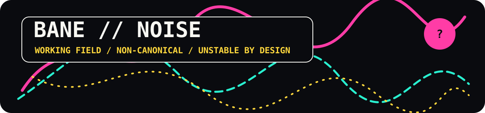

<p align="center">
  
</p>

# `sololys/epistemic-architectures-notes` — Working Field & Spectral Notes (Morandi-Core)

$$\boxed{\text{BANE // NOISE} \xrightarrow{\Pi_K} \text{STRUCTURE} \xrightarrow{\text{Review}} \text{PUNKT // THEORY}}$$

**Compiled Ingress (EN):** Non-canonical working field (`BANE`) containing mathematical derivations, spectral proofs (`COS45`), and field protocols strictly separated from canonical architectural law ([`sololys/epistemic-architectures`](https://github.com/sololys/epistemic-architectures)). Zero external dependencies ($\Sigma_{\text{ext}} = \emptyset$). Zero physical authority (`0.00 V DC`).
**Kompilert Ingress (NO):** Ikke-kanonisk arbeidsfelt (`BANE`) med matematiske utledninger, spektralbevis (`COS45`) og feltprotokoller, strengt adskilt fra den kanoniske loven ([`sololys/epistemic-architectures`](https://github.com/sololys/epistemic-architectures)). Null eksterne avhengigheter ($\Sigma_{\text{ext}} = \emptyset$). Null fysisk autoritet (`0,00 V DC`).

* **Author:** Marius Egerhei Torjusen ([ORCID: `0009-0006-0431-6637`](https://orcid.org/0009-0006-0431-6637) · [Zenodo DOIs: `10.5281/zenodo.18515422`](https://doi.org/10.5281/zenodo.18515422) · [`10.5281/zenodo.22229111`](https://doi.org/10.5281/zenodo.22229111))

---

## I. Execution Contract (`Makefile`)

```bash
# Default invocation fails closed by design (HOLD = 0.00 V DC):
make
# -> [HOLD] 0.00 V DC. System is at rest. (exit code 1)

# Full deterministic verification of L1_LAW, L2_GATE, COS45 Spectral Series, and Public IP Gate:
make verify
```

---

## II. Subtractive Room Topology

The root directory (`/`) contains only this surface index (`README.md`) and the execution contract (`Makefile`).

| Room | Role | Primary Artifacts |
| :--- | :--- | :--- |
| **[`L1_LAW/`](L1_LAW/)** | Pure mathematical definitions (`invariants_pure.py`). Zero I/O. | [`invariants_pure.py`](L1_LAW/invariants_pure.py) |
| **[`L2_GATE/`](L2_GATE/)** | Boundary projection & consequence gate evaluator ($\Omega \circ \Pi_K$). | [`evaluate_boundaries.py`](L2_GATE/evaluate_boundaries.py) |
| **[`L3_WITNESS/`](L3_WITNESS/)** | Append-only SHA-256 cryptographic receipts ($W^2$). | [`audit_log.jsonl`](L3_WITNESS/audit_log.jsonl) |
| **[`notes/`](notes/)** | Working monographs, mathematical derivations, and field protocols. | See Section III below |
| **[`tools/`](tools/)** | Spectral series verifier (`COS45`) & Public IP Gate verifier. | [`verify_cos45_kms_spectral_series.py`](tools/verify_cos45_kms_spectral_series.py) · [`verify_public_surface.py`](tools/verify_public_surface.py) |
| **[`verdensbiblioteket/`](verdensbiblioteket/)** | Visual & HTML reference plates. | [`index.html`](verdensbiblioteket/index.html) · [`sololys_popart_renaissance_plates.html`](verdensbiblioteket/sololys_popart_renaissance_plates.html) |

---

## III. Working Monographs & Field Protocols (`notes/`)

- **[`notes/IT_OT_CONSEQUENCE_GATE_NORCICS_BRIEF.md`](notes/IT_OT_CONSEQUENCE_GATE_NORCICS_BRIEF.md)** — *Non-AI Consequence Gating for IT-OT Integration in Critical Infrastructure ($\Phi \to \Pi_K \to \Omega \to W^2$)*.
- **[`notes/LAW_OF_CAUSAL_INERTIA.md`](notes/LAW_OF_CAUSAL_INERTIA.md)** — *Treghetens lov // The Law of Causal Inertia (`FEATURE-NEWYORKER-INERTIA-2026-v1.0`, $\Phi(x_t) \neq x_{t+1}$)* ([Zenodo DOI: `10.5281/zenodo.22229111`](https://doi.org/10.5281/zenodo.22229111)).
- **[`notes/METRISK_INVARIANS_SPEKTRAL_KONVERGENS_OG_HORISONTENS_LOV.md`](notes/METRISK_INVARIANS_SPEKTRAL_KONVERGENS_OG_HORISONTENS_LOV.md)** — *Sections XII–XIV: Skribentens Lov ($\min |p| \land \max T(p^*)$), Kompleksitetskollaps ($|\mathcal{A}(\partial K)| \le 1$), Grassmann-perturbasjon ($\|dP\|_F = \sqrt{2}\|dP\|_{\text{Gr}}$), og Horisontens Lov (`PROVISIONAL_HOLD`)*.
- **[`notes/MORISSETTE_TORJUSEN_COS45_FRONTIER_AND_PROTOCOL.md`](notes/MORISSETTE_TORJUSEN_COS45_FRONTIER_AND_PROTOCOL.md)** — *Exact Resolution of the COS45 Frontier Constants and Pre-Registered 5-Gate Temporal Safety Protocol*.
- **[`notes/DOR_30_OG_DOR_31_TEKNISK_ARKITEKTURSPESIFIKASJON.md`](notes/DOR_30_OG_DOR_31_TEKNISK_ARKITEKTURSPESIFIKASJON.md)** — *Door 30 (`U_1–U_{10}`) & Door 31 (`Z_1–Z_{10}`) Technical Architecture Specification*.
- **[`notes/KPOD_V12_L3_15N2_NMR_LAB_PROTOCOL.md`](notes/KPOD_V12_L3_15N2_NMR_LAB_PROTOCOL.md)** — *K-POD v1.2 Operational $^{15}\text{N}_2$ / $^1\text{H-NMR}$ ($72.5\text{ Hz}$) Laboratory Protocol (`K1`–`K6`, `Lock 0`)*.
- **[`notes/ZAMPINO_NASH_AN_INTERESTING_EQUATION.md`](notes/ZAMPINO_NASH_AN_INTERESTING_EQUATION.md)** — *Zampino–Nash: An Interesting Equation*.
- **[`notes/ESSAY_140_METERS_ABOVE_GROUND_SQRT_N_CONSEQUENCE_GATE.md`](notes/ESSAY_140_METERS_ABOVE_GROUND_SQRT_N_CONSEQUENCE_GATE.md)** — *140 Meters Above Ground: Why $\sqrt{N}$ Separates Collective Order from Exponential Chaos* ([LinkedIn Pulse](https://www.linkedin.com/pulse/140-meters-above-ground-why-n-separates-collective-order-torjusen-pvqye/)).
- **[`notes/ESSAY_THE_TYRANNY_OF_THE_FRICTIONLESS_NEWYORKER.md`](notes/ESSAY_THE_TYRANNY_OF_THE_FRICTIONLESS_NEWYORKER.md)** — *The Tyranny of the Frictionless (The 2:14 A.M. Hypothesis & The Odysseus Pact)*.
- **[`notes/HUKOMMELSENS_TERSKEL.md`](notes/HUKOMMELSENS_TERSKEL.md)** — *Hukommelsens Terskel*.
- **[`notes/governance.md`](notes/governance.md)** · **[`notes/epistemic-exposure.md`](notes/epistemic-exposure.md)** · **[`notes/meta-awareness.md`](notes/meta-awareness.md)** · **[`notes/ECOSYSTEM.md`](notes/ECOSYSTEM.md)** · **[`notes/CONTRIBUTING.md`](notes/CONTRIBUTING.md)**

---

## IV. Status Contract

```text
CANONICAL          = false
COMPLETE           = false
CONSISTENT         = not_guaranteed
CHANGE_EXPECTED    = true
PHYSICAL_AUTHORITY = none (0.00 V DC)
```

---

<p align="center"><code>EXPLORE FREELY / PROMOTE DELIBERATELY / NEVER CONFUSE LOCATION WITH AUTHORITY</code></p>

<!-- SOVEREIGN_CONSTELLATION_MAP_START -->
---

## 🧭 Sovereign Architecture Constellation (Cross-Repository Matrix)

This repository is part of a 6-layer deterministic engineering constellation (`L1` software & hardware verification, `INSPIRED_BY != IMPLEMENTS != PROVES`):

| Layer | Repository | Core Engineering Scope | Deterministic Verification |
| :--- | :--- | :--- | :--- |
| **L1 — Law & Monoliths** | [`sololys/ky-rox-public-demonstrators`](https://github.com/sololys/ky-rox-public-demonstrators) | The 7 Public Monoliths: Light Bridge, Euclidean Phase Cone, Point // Trajectory, Kernel Drift, Davisson–Fine–Newton, KY v1.5-MASTER & Staggered-PRF SDR Gate | `42/42 PASS` + `7/7 L1_LAW` |
| **L2 — RTL & Subspace** | [`sololys/epistemic-architectures-notes`](https://github.com/sololys/epistemic-architectures-notes) | COS45 Hankel-SVD Grassmann subspace projection, clocked SystemVerilog RTL (`0.00 V` quench) & Davisson–Fine–Newton Gate | `26/26 PASS` (`PUBLIC_IP_GATE=PASS`) |
| **L3 — Phase & Horizon** | [`sololys/FASE_SPEIL_v0_1`](https://github.com/sololys/FASE_SPEIL_v0_1) | Davisson Bragg coherence ($54\text{ V}/50^\circ$), Fine–Wilf ghost-word detector ($L^* = p+q-\gcd(p,q) = 12$) & Staggered-PRF SDR filter | `26/26 PASS` |
| **L4 — Local-First Net** | [`sololys/Infranett`](https://github.com/sololys/Infranett) | Infranett v0.4: $S_0 = \text{GATE::HOLD}$, Time-of-Flight $d \le 20\text{ m}$, `Noise_KK` 0-RTT & causal persistence (`fsync < RAM < ACK`) | `26/26 PASS` |
| **L5 — Continuous Path** | [`sololys/OrgelKraft`](https://github.com/sololys/OrgelKraft) | Continuous mechanical & acoustic work integration ($\Delta E_k = \int F\,dx$) & multi-period harmonic horizon | `26/26 PASS` |
| **L6 — Cognitive Shield** | [`sololys/TonderSheeld`](https://github.com/sololys/TonderSheeld) | Synthetic psychosomatics, Schaerbeek ceiling ($2^{12}$), Landauer erasure floor ($E_{\min} = k_B T \ln 2$) & Diurnal Gearbox ($S_1$–$S_5$) | `26/26 PASS` |
<!-- SOVEREIGN_CONSTELLATION_MAP_END -->
